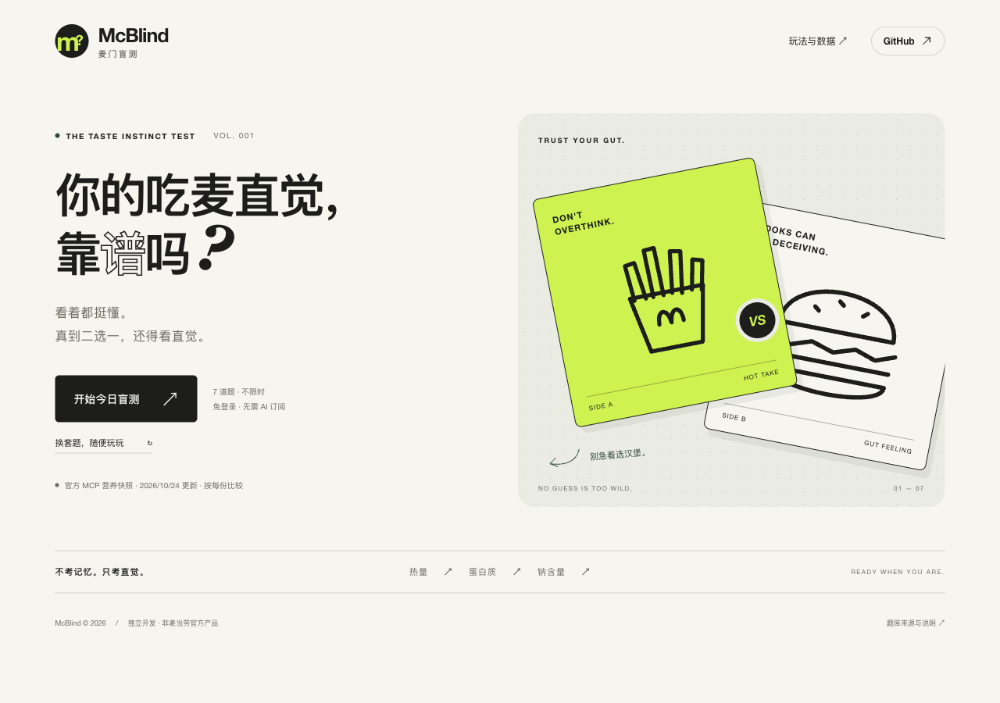
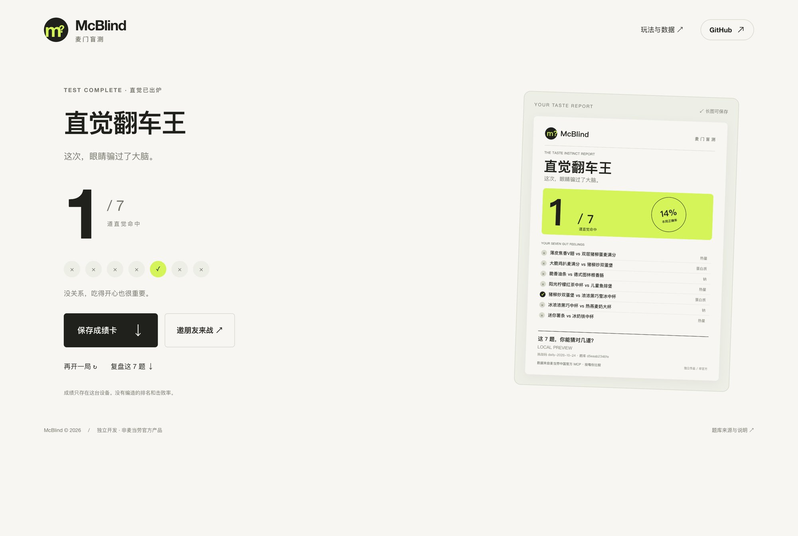

<p align="center"><strong>McBlind / 麦门盲测</strong></p>

# 你的吃麦直觉，靠谱吗？

**两份餐品，谁热量更高？谁蛋白质更多？看着很懂，一选就懵。**

7 道二选一，答完即刻生成一张成绩卡。把同一套题丢给朋友，看看谁才是「麦门满分人」。

> 已完成官方 MCP 实测接入：内置 **158 款餐品**的营养快照，采集于 **2026 年 10 月 24 日**。玩家打开即可挑战，无需配置 Token；维护者可随时同步更新。

<!-- 发布后可将下一行替换为实际 GitHub Pages 在线试玩链接。 -->
**本地试玩：** `npm run dev` → 打开 http://127.0.0.1:4173





## 为什么值得玩一次

- **免登录、免密钥试玩。** 网页是纯静态站，没有模型调用费，不要求玩家拥有 MCP Token。
- **7 题，不限时。** 在热量、蛋白质和钠之间切换，答完显示双方具体数值；只比数据，不给食物贴好坏标签。
- **同题挑战。** 北京时间每日一套，或随机换题；分享链接带挑战码和题库版本，朋友收到的是同一版本的同一组题。
- **成绩有实物感。** 一键保存 1080 × 1440 PNG 卡片，含题目回顾、成绩、挑战码与数据标识；没有虚假的百分位和排行榜。
- **也能在聊天里玩。** 项目自带 [Agent Skill](.agents/skills/mcblind/SKILL.md)，可以让助手逐题主持、判分和复盘。
- **数据可核对。** 官方数据通过只读 MCP 获取，网页标明采集日期，题库内容变化会触发版本提示。

## 30 秒跑起来

需要 **Node.js 22 或更新版本**。零第三方依赖，不必运行 `npm install`。

```bash
git clone https://github.com/sheben404/mcblind.git
cd mcblind
npm run dev
```

打开 http://127.0.0.1:4173 。手机也能玩部署后的静态站。内置官方营养快照，不需要玩家配置 Token。

## 接入麦当劳官方营养数据

1. 在 [麦当劳 MCP 开放平台](https://open.mcd.cn/mcp)手机号登录，进入控制台并激活 Token。
2. 在仓库根目录将 `.env.example` 复制成 `.env.local`，在本机编辑 `MCD_MCP_TOKEN`。该文件已被 Git 忽略。
3. 运行同步后刷新网页：

```bash
npm run sync
```

也支持已有的 `MCD_MCP_TOKEN` 环境变量。不需要把 Token 发给开发者或任何聊天助手。

同步完成后只输出餐品数量、采集时间和题库版本。**网页不接收、不保存、不上传玩家的 Token**；工具原始响应不会存入公开目录。鉴权、解析、数据冲突或网络失败时，脚本保留旧题库并返回非零退出码。

实际使用的唯一业务 Tool 是 `list-nutrition-foods`，不访问个人地址、订单、券包、积分或支付。完整调用流程见 [MCP_INTEGRATION.md](MCP_INTEGRATION.md)。

## 让你的 Agent 主持一局

项目已经在 `.agents/skills/mcblind/SKILL.md` 中提供项目 Skill。在能识别该目录的 Agent 中打开这个仓库，并说：

> 用 mcblind 给我来一轮盲测，一次一题，先别透露答案。

也可将该文件内容作为项目指引交给支持 Skill 的客户端使用；需要保留完整仓库才能运行脚本。

```bash
# 生成同一版本的固定挑战（JSON 包含答案，主持时先别给玩家看）
npm run challenge -- friend-1024
```

## 发给朋友

成绩页的「保存成绩卡」会导出 PNG，「邀朋友来战」会复制带挑战码的链接与成绩文案。本机 `127.0.0.1` 链接只能在当前电脑打开，公开分享前先部署 `web/`。

仓库包含手动触发的 [GitHub Pages 工作流](.github/workflows/pages.yml)：在仓库 Settings → Pages 中选 GitHub Actions，然后在 Actions 里运行 **Deploy McBlind**。它只上传 `web/`，不会上传 `.env.local`、Skill、测试或本地调用收据。

也可把 `web/` 部署到任意静态托管服务；无需服务器、数据库、构建命令或第三方字体。部署到子目录也能工作。每次更新题库后需重新部署，访客不会触发官方接口请求。

## 本地检查

```bash
npm test
npm run check
```

测试覆盖分享挑战的确定性、时区、判分、无平局选题、官方紧凑营养表解析、零值与缺失值、JSON/SSE 响应、MCP 握手和 Token 请求边界。`check` 检查参赛文件、Skill 与题库状态，演示题库会明确提示真实接入尚未完成。

## 技术与边界

原生 HTML / CSS / JavaScript + Node.js 标准库；无构建、无追踪脚本。插图为原创 SVG 线稿，未使用品牌 Logo 或官方餐品图片。成绩仅保存在当前设备的 localStorage（禁用存储仍可游玩）。玩家可用开发者工具查看静态题库，因此这是朋友间的知识小游戏，不是有防作弊保证的竞技考试。

题库比较的是各餐品标示的一份，**不是等重量或每 100 克对比**。数据是采集时快照，不代表门店当前在售状况，也不构成饮食或医疗建议。作品由参赛者独立开发，非麦当劳官方产品。

参赛文件：[参赛声明](CONTEST_DECLARATION.md) · [MCP 接入](MCP_INTEGRATION.md) · [报名草稿](docs/registration.md)

**如果它让你猜错了一题，欢迎 Star 一下，让下一位也来试试。**

MIT License © 2026 Khan Wang。MIT 授权适用于本项目原创代码与原创插图；官方参赛声明和通过 MCP 获取的数据仍遵循其来源的相关条款。
